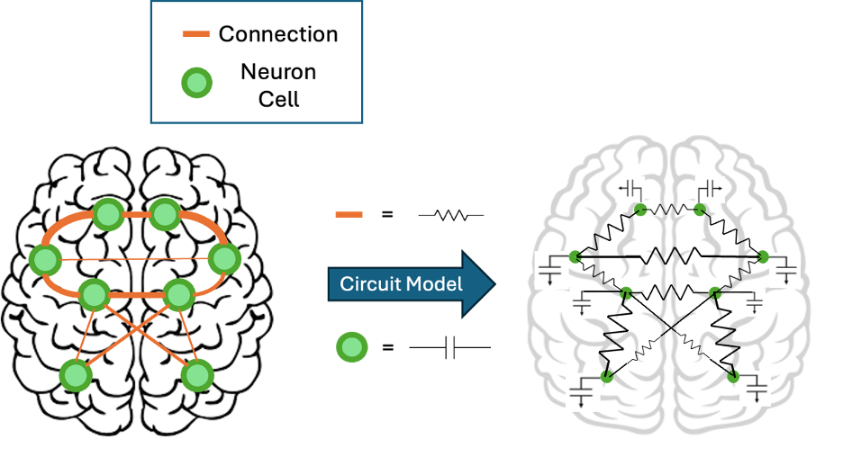

# TMS_RC_Model
This project taken brain structural connectomes as a large resistor capacitor network. The stimulation generated by TMS coils will provide the external charges into certain nodes at beginning. Then we use the electrical equations(KVL) at each node changing with time to build the ODE matrix. In the end we solve this ODEs and get nodes' voltage. 
This is the code and data release for the paper *An Electrical Circuit Model of Whole-Brain Spatiotemporal Dynamics Following Focal Brain Stimulation* (In Preparation). It contains only the basic linear RC model codes used in the paper here.

*The resistor-capacitor circuit based on the brain structural connectome network. The green nodes are the targeting brain regions we concerned, and the orange lines stands for the connection between those regions. In order to analyse the signal propagation through such network, we can take brain regions as capacitors and the connections as resistors. Then the brain network is transferred to a resistor-capacitor circuit network which we can use electric circuit knowledge to solve such network.*

## Repository layout

```text
code/
  RC_toy.m                      Step 2.1  n-node toy RC network
  RC_atlas_single.m             Step 2.2  Schaefer-1000 + 12 subcortex model, single-node input
  RC_atlas_SimNIBS.m            Step 2.2  same model, SimNIBS E-field input
  Downsample_N_brain_map.m      Step 2.3  k-d-tree downsampling of the 91,282-node connectome
  RC_high_res_downsampled.m     Steps 3–5 downsampled high-resolution model (TMS E-field input)
  tms_fmri/                     Step 6.1  TMS-fMRI comparison (Supplementary Section S2)
  ftract_seeg/                  Steps 2.4, 4.3, 5.2, 6.2, 6.3  F-TRACT comparison, MATLAB
  python_figures/               Step 6.4  Python scripts that produce the manuscript's Figs 3–5
data/                           cluster partition, E-field, coordinates and spin-test files; the connectome
                                inputs are not redistributed, see "Data files" at the end
images/                         schematic
docs/tms_efield_pipeline_2024.md   the original step-by-step notes this README grew from
LICENSE                         MIT
```

## Step 1: TMS E-Field Simulation in SimNIBS

*This section explains how to position the TMS coil in SimNIBS at a specified MNI-space location and run the electric field (E-field) simulation.*

### 1.1 Define MNI Coordinates(Optional if you know the subject coordinates)
In this project we use the empircal TMS-fMRI data provided by Tik's group(Tik, Woletz et al. 2023). 
In their TMS experiments their targeting position is in mni-space with a coordinate: (-42, 28, 21) with an angle of 45 degree against the brain surface.The coil they used is a Figure-8 coil with a diameter of 70mm.


In this project, we use empirical TMS-fMRI data provided by Tik's group (Tik, Woletz et al., 2023). Their experiments target a position in MNI space at coordinates `(-42, 28, 21)`, with the coil positioned at a 45-degree angle against the brain surface. They used a Figure-8 coil with a diameter of 70mm.

- **Target MNI Coordinates**: `(-42, 28, 21)`

> **Note**: If your empirical data includes a different MNI coordinate, substitute it in the above step.  
> If you already know the subject-specific coordinates of the coil, you can skip Step 1.3.

**Software Required**: [SimNIBS](https://simnibs.github.io/simnibs/) (v4.0.0 or later)

### 1.2 Build and Choose the Head Model in SimNIBS (FEM Software)

SimNIBS is an FEM (Finite Element Method) software that simulates the electromagnetic field generated by TMS coils within the brain. For detailed instructions, refer to the [SimNIBS tutorial](https://simnibs.github.io/simnibs/build/html/tutorial/tutorial.html).

**Using a Head Model**: It’s essential to use a compatible head model for accurate simulation results. In this project, we use a pre-built head model provided by SimNIBS, located at:

```shell
/simnibs_examples/ernie/m2m_ernie/
```


### 1.3 Convert MNI to Subject Coordinates
In this step we will convert the mni-space coordinates to the subject ones using the command `mni2subject_coords` in SimNIBs. Use the command `mni2subject_coords -h` or check the SimNIBs website for more details.

Run in your terminal with below commands(make sure you have alread installed the **SimNIBS**):
```shell
mni2subject_coords -m simnibs_examples/ernie/m2m_ernie/ -c -42 28 21  -o subject_TMS_coords.csv
```

The result is written in the `subject_TMS_coords.csv` and in this case the subject coordinates is:  
```shell
(-42.30, 28.12, 53.64)
```


### 1.4 Set the Coil's Coordinate and Angle in SimNIBS
After get the subject coordinate, the next step is set the TMS coil's coordinate and angle in the SimNIBS. The angle we used in this setup is the vector type: `[0 1 0]` in the approximate of the coil angle of 45 degree against the brain surface.


### 1.5 Run the Simulation and Extract the Electric Field

After setting up the TMS coil position and angle, run the simulation in SimNIBS. The output will generate a file (e.g., `ernie_TMS_1-0001_Magstim_70mm_Fig8_nii_scalar.msh`) in your designated output folder. This `.msh` file contains the 3D electric field distribution from the simulation.

In this project, we aim to extract the electric field values specifically on the **white matter surface**. To do this, we’ll use the [HCP S1200 group average surfaces](https://www.humanconnectome.org/study/hcp-young-adult/article/s1200-group-average-data-r...) as a reference surface.

#### Requirements

Before extracting electric field data on the surface map, you need to install the [Connectome Workbench](https://www.humanconnectome.org/software/get-connectome-workbench) software. This provides the `wb_command` utility, which includes the `get_fields_at_coordinates` function we will use.

> **Note**: If you’re on a Mac with an M-series chip, you may encounter compatibility issues with the command-line tools. If possible, use a computer with an Intel chip or a Windows version of Connectome Workbench to ensure functionality.

#### Preparing Coordinates of Interest

To extract the electric field at specific nodes in the structural connectome, use the file `subject_coord_91k.csv`, which contains high-resolution (fs32k) structural connectome nodes in subject space. This CSV file lists the subject coordinates in the same order as the nodes in the structural connectivity matrix.

- **CSV File**: `subject_coord_91k.csv`
- **Uploaded this sample csv file at:**: `/data/subject_coord_91k.csv`

#### Extracting E-Field Values at the Specified Nodes

Use the following command in your terminal to extract the electric field values at the specified coordinates from your simulation output file:

```shell
get_fields_at_coordinates -s <path_to_csv>/subject_coord_91k.csv -m <path_to_simnibs_result>/ernie_TMS_1-0001_Magstim_70mm_Fig8_nii_scalar.msh
```

- Replace `<path_to_csv>` with the directory path to the file `subject_coord_91k.csv` you placed.
- Replace `<path_to_simnibs_result>` with the directory path same as the path you used for your SimNIBS output folder.

After this command you will get a new csv file named `subject_coord_91k_normE.csv` which contains the extracted E-field of the structural connectome network.


## Step 2: Building the RC Circuit in MATLAB

In this step, we model the brain’s structural connectivity as a resistor-capacitor (RC) network. This approach treats brain regions as nodes connected by resistive and capacitive elements, simulating how an initial stimulus (generated by TMS) propagates through the network over time. This step is divided into three different models, each increasing in complexity and resolution:

### 2.1 Toy Model (Five-Node Model)

**Files** — script: `code/RC_toy.m`; no input files.

`code/RC_toy.m` builds an `n`-node RC network (default `n = 5`) with user-set resistances and capacitances, stimulates one node and plots the voltages.

The toy model provides a simplified version of the RC network, using only five nodes(or any n nodes if you wish). This smaller network allows us to implement and test the basic principles of the RC circuit model and evaluate the effects of TMS-driven stimulation in a manageable setup. Each node represents a distinct "region" with a capacitor connected to the ground and each connection between nodes is treated as a resistor.
**MATLAB Script**: The script for the toy model (`RC_toy.m`) is available in the repository. This script allows users to modify the number of nodes, resistance, and capacitance values to fit your own setup.

### 2.2 Atlas Segmentation Model

**Files** — scripts: `code/RC_atlas_single.m`, `code/RC_atlas_SimNIBS.m`; input: the Schaefer-1000 SC and distance matrices (not redistributed), `data/Schreorder.csv`, `data/Subcortex-Sina.csv`, and for the E-field version `data/subject_coord_91k_normE.csv`.

`code/RC_atlas_single.m` (single-node input) and `code/RC_atlas_SimNIBS.m` (E-field input) use the [Schaefer 2018](https://github.com/ThomasYeoLab/CBIG/tree/v0.14.3-Update_Yeo2011_Schaefer2018_labelname/stable_projects/brain_parcellation/Schaefer2018_LocalGlobal/Parcellations) 1000-parcel atlas plus 12 subcortical regions. Inputs: the Schaefer-1000 + subcortex group SC and distance matrices (`SC_ds_hcp_tract_pro_ctx_sch7n1000p_sctx_fs14_*.mat`, `ED_ctx_sch7n1000p_sctx_na.mat`; HCP-derived connectomes of Mansour et al. 2021, **not redistributed**) and the ordering tables `data/Schreorder.csv`, `data/Subcortex-Sina.csv`. 

The atlas segmentation model uses a standardized brain atlas, in this case we used the *Schaefer 2018* atlas map with 1000 cortical regions and 12 subcortex regions involved, to represent brain regions at a more realistic scale than the toy model. Each region in the atlas acts as a node in the network, and connections between regions are weighted according to structural connectivity data. This model provides more anatomical accuracy while still remaining computationally efficient.

### 2.3 Parcel-level model for the F-TRACT comparison (Glasser 360 + 14 subcortex, N = 374)

**Files** — scripts: `code/ftract_seeg/RC_FTRACT_ODE_V23.m`, `code/ftract_seeg/RC_ftract_Caio_data.m`; input: `SC_data_neuron_2023_yihang.mat` or `X_struct_v1-19_FCO.mat`, and the ordering vectors (none redistributed, see Data files).

Direct-electrical-stimulation responses in F-TRACT are tabulated on the HCP-MMP1.0 (Glasser) atlas, so the main validation uses a 374-node connectome: 360 cortical parcels (rows 1–360) and 14 subcortical regions (361–374; bilateral thalamus, caudate, putamen, pallidum, hippocampus, amygdala, accumbens; Tian et al. 2020). The HCP group consensus connectome (streamline count normalised by regional surface area, consensus over participants; Mansour et al. 2021, Seguin et al. 2023) is **not part of this repository**. We recommend building the connectome yourself from the HCP (1,000 participants) diffusion data with the pipeline of Mansour et al. (2021) ([sina-mansour/neural-identity](https://github.com/sina-mansour/neural-identity)); the specific matrices used here can be requested from Caio Seguin, Sina Mansour or the authors of this manuscript. In our analyses it is stored as `SC_data_neuron_2023_yihang.mat` with variables

| Variable | Size | Meaning |
|---|---|---|
| `SC` | 374 × 374 | structural connectivity weight `W_ij` |
| `D` | 374 × 374 | inter-regional distance `L_ij` (mm) |
| `F` | 374 × 374 | fraction of participants in which the connection exists |
| `parcel_list` | 374 × 1 | region labels in matrix order |


---

### 2.4 High-Resolution (Full-Size Structural Connectome, downsampled) Model

**Files** — scripts: `code/Downsample_N_brain_map.m` (downsampling), `code/tms_fmri/RC_91k.m` (full resolution); input: `data/mnipositionc.csv`, `data/Subcortex-Sina.csv`, `data/subject_coord_91k_normE.csv` and the 91,282-node SC / tract-length matrices (`SCCount.mat`, `SCLength.mat`, not distributed); output: `data/tms_9656/SC_downsampled.mat`, `D_downsampled.mat`, `E_downsampled.mat` (saved by the script as `V_downsampled.mat`), `group_indices.mat`.


The full connectome has 91,282 nodes (fs_LR 32k cortex + subcortex) and needs ≥ 64 GB RAM in MATLAB (`code/tms_fmri/RC_91k.m`). For the manuscript we therefore downsample it with `code/Downsample_N_brain_map.m`:
> **Note:** Due to the large number of nodes and connections, this model using the full high-resolution matrices can be memory-intensive(request for 64GB memory for running the code in MATLAB) and require long computation times, we also provided a downsampling method which can downsample the nodes into clusters(e.g., 4x, 8x, or 10x ...). 
>

1. Nodes are first divided by hemisphere and by anatomical structure (`data/Subcortex-Sina.csv` gives the index ranges), so that no cluster straddles two structures.
2. Within each division, an iterative k-nearest-neighbour search on a k-d tree (`knnsearch`) groups the next unvisited node with its `k = 10` nearest unvisited neighbours that lie within `max_dist = 10 mm`; clusters smaller than `k/2` are merged with close neighbours. Each cluster is represented by its centroid.
3. For every pair of clusters the SC weight and the tract length are the means of the corresponding sub-matrix of the 91k connectome (diagonal set to 0); the E-field is the mean over the nodes of each cluster.

Outputs: `SC_downsampled.mat`, `D_downsampled.mat` (9,656 × 9,656, symmetric, 11.2 M non-zero entries each), `E_downsampled.mat` (9,656 × 1) and `group_indices.mat` (the member grayordinates of every cluster — this is the partition used in all high-resolution results). All of these, including the two large matrices, are in `data/tms_9656/`.

The high-resolution model employs a full size structural connectome with maximum available detail, representing brain regions at a much finer scale.  Nodes correspond to high-resolution white matter voxels, and connections are based on high-resolution structural connectome data. This model captures a detailed view of TMS signal propagation but it requires significant computational resources for simulation.

---

Each model builds on the previous one, allowing us to gradually scale the RC circuit from a simplified system to a high-resolution network that closely represents the actual brain connectome. In the matlab codes we will introduce the process to build and run those models in detail, please look through each matlab scripts for a better understanding of the models.

## Step 3: Setup Boundary Conditions

In this step, we setup all the boundary conditions for our ODE system: initial boundary and time-scale length setup. These boundary conditions is nessecary for our model to solve the dynamic solutions for each node's voltage equations.

### 3.1 Input bounday condition

**Files** — scripts: the simulation scripts listed in the table (the initial condition is set near the top of each); input: `data/tms_9656/E_downsampled.mat` for TMS, none for direct electrical stimulation.

The stimulus pulse (1 ms for SEEG, < 1 ms for TMS) is short compared with the 50–200 ms propagation window, so it is applied as an **initial voltage** rather than a sustained current: the capacitor of each stimulated node is charged at `t = 0` and no external current flows afterwards (`I_i(t) = 0` for `t > 0`).

| Modality | Script | Initial condition |
|---|---|---|
| Direct electrical stimulation (F-TRACT) | `code/ftract_seeg/RC_FTRACT_ODE_V23.m`, `RC_ftract_Caio_data.m`, `rc_visualization_demo.m` | `V0 = 0` everywhere, `V0(stim) = 1`. The loop runs over all 360 cortical stimulation sites in turn. The absolute value is arbitrary; only relative patterns are interpreted. |
| TMS, E-field input | `code/RC_high_res_downsampled.m` | `V0 = E_downsampled` (cluster-mean E-field magnitude from Step 1.5 / 2.3). In the released version the field is concentrated on the cluster with the largest E-field (`V(max_idx) = 2*max_val`); the commented alternatives apply the whole field or its top percentile. |
| TMS + auditory co-stimulation | `code/tms_fmri/RC_High_Mapping.m` | As above plus a second and third source at the mass centres of the left and right auditory cortices, to model the coil click (Supplementary Fig. S7). |
| Toy / atlas tutorial | `code/RC_toy.m`, `RC_atlas_*.m` | `V0(target_node) = 1`, or the Schaefer-parcel mean E-field. |

### 3.2 Resistance and capacitance from the connectome

**Files** — scripts: `code/RC_high_res_downsampled.m` (section *Data Preparation*; uses `data/tms_9656/SC_downsampled.mat`, `D_downsampled.mat`, `group_indices.mat`), `code/ftract_seeg/RC_FTRACT_ODE_V23.m`, `RC_ftract_Caio_data.m`, `rc_visualization_demo.m` (374-node SC and distance).

Each connection is a bundle of parallel axons with length `L_ij` and an effective cross-section proportional to the connectivity weight `W_ij`:

```text
R_ij = rho * L_ij / W_ij        (W_ij > 0; no resistor where W_ij = 0)
G_ij = 1 / R_ij
```

`rho` is a global scale fixed at 1 in all released scripts (it only rescales time). The scripts build `R = D ./ SC`, set non-finite entries to zero, and `G(mask) = 1./R(mask)`. In the F-TRACT scripts, connections present in fewer than 25 % of participants (`F < 0.25`) are removed where stated.

Capacitance scales with the anatomical size of a node:

```text
C_i = c * A_i
```

* **High-resolution TMS model**: `A_i` is the number of grayordinates in cluster `i` (`C(group) = group_size * 100` in `RC_high_res_downsampled.m`), so larger clusters store more charge. At full 91k resolution every node is one grayordinate and `C` is uniform.
* **Parcel-level F-TRACT model**: uniform capacitance (`C = 1` in `RC_FTRACT_ODE_V23.m` and `rc_visualization_demo.m`, `C = 0.1` in `RC_ftract_Caio_data.m`). Parcel size is not used at this resolution.

### 3.3 Time scale and resolution

**Files** — the parameters `time_scale` and `num_points` are set in the *Adjustable / User parameters* block at the top of each simulation script.

| Model | `time_scale` | `num_points` | Solver |
|---|---|---|---|
| High-resolution TMS (9,656 nodes) | 50 (model ms) | 100 | `ode23`, evaluated with `deval` |
| Parcel-level F-TRACT | 200 ms | 2,000 (`rc_visualization_demo.m`) or 5,000 (`RC_FTRACT_ODE_V23.m`) | `ode45` |
| Atlas / toy | 0.5–1 | 100 | `ode45` |

Simulated time is model time: the parameters were scaled so that the dominant transient falls within the window of cortico-cortical evoked potentials, and results are interpreted as relative patterns and relative timing.

---


## Step 4: Solve the ODE System and Extract Output Metrics

### 4.1 Governing equations

**Files** — functions: `capODE_downsampled` in `code/RC_high_res_downsampled.m`, `rc_ode_rhs` in `code/ftract_seeg/RC_FTRACT_ODE_V23.m`, the inline right-hand side in `rc_visualization_demo.m`, and `simulate_rc` in `code/python_figures/rc_ftract_core.py`.

Kirchhoff's current law at node `i`:

```text
C_i dV_i/dt = sum_j G_ij (V_j - V_i) + I_i(t)
```

or in matrix form `C dV/dt = -L V + I`, where `L = diag(sum_j G_ij) - G` is the weighted graph Laplacian of the conductance matrix. The right-hand side is implemented either as an explicit double loop over connected pairs (`capODE_downsampled`, `rc_ode_rhs`) or as `(-L*V + I_input) ./ C` (`rc_visualization_demo.m`); both are the same linear system.

### 4.2 Node currents and metrics in the high-resolution TMS model

**Files** — scripts: `code/RC_high_res_downsampled.m`, `code/tms_fmri/RC_High_Mapping.m`; output: `ODESolver/voltage.mat`, `I.mat`, `Ip.mat`, `Imax.mat`, `Ipmax.mat`, `E1max.mat`, `Cpmax.mat`.

From the voltage traces `v(i, t)`, `RC_high_res_downsampled.m` computes for every node and time point the inward current from neighbours with higher voltage (`Ip`) and the outward current to neighbours with lower voltage (`In`), using `(v_j - v_i) / R_ji / 2`, and then

| Metric | Definition | File |
|---|---|---|
| `Imax` | `max_t (Ip + In)` — peak total current | `ODESolver/Imax.mat` |
| `Ipmax` | `max_t Ip` — peak positive (inward) current | `ODESolver/Ipmax.mat` |
| `Cpmax` | `max_t ∫ |Ip| dt` — accumulated positive charge | `ODESolver/Cpmax.mat` |
| `E1max` (Emax) | `max_t ∫ |I · v| dt` — accumulated energy | `ODESolver/E1max.mat` |

All four are compared with TMS-fMRI in Step 6.1 (Supplementary Figs S3, S5, S7).

### 4.3 Node current, peak current and time-to-peak in the parcel-level model

**Files** — scripts: `code/ftract_seeg/RC_FTRACT_ODE_V23.m`, `rc_visualization_demo.m`, `RC_delay_scatter_refine.m`; Python: `code/python_figures/simulate_rc_peak_xstruct.py`; output: `I_node_max`, `TTP` (`rc_outputs_minimal.mat`; `output/fig3a_bootstrap_ci/rc_peak_xstruct_w.npz`).


For each stimulation site `s` the F-TRACT scripts compute the total absolute current through node `i`,

```text
I_i(t) = sum_j | G_ij (V_i(t) - V_j(t)) |
```

and store, with rows = target nodes and columns = stimulation nodes:

* `I_node_max(i, s) = max_t I_i(t)` — **peak propagation strength**, the quantity compared with F-TRACT response probability and amplitude (Figs 3, 4);
* `TTP(i, s)` — time of the peak of `I_i(t)` (`rc_visualization_demo.m`), and the decay constant `Tau` and `HalfLife` fitted to the post-peak tail;
* `DEL` (`rc_compute_delays_from_V` inside `RC_delay_scatter_refine.m`) — alternative timing read-outs of the same traces explored in the MATLAB script: first-passage time, mean transit time and `q50_I` (time at which the cumulative node current reaches half of its final value). The manuscript's Fig. 5 is produced by the Python scripts of Step 6.4, which use `TTP`, the time of the peak of `I_i(t)`, with values ≥ 200 ms set to `NaN`.

`rc_visualization_demo.m` saves everything in `rc_outputs_minimal.mat`.

---


## Step 5: Visualisation

### 5.1 Expanding the downsampled result back to 91k and writing CIFTI files

**Files** — script: `code/RC_high_res_downsampled.m` (sections *Expand Downsampled Data to Original Resolution* and *Plotting to dscalar Files*); input: `data/tms_9656/group_indices.mat`, the `ODESolver/*.mat` metrics and the template `ones.dscalar.nii`; output: `*_full.mat` and `.dscalar.nii` maps.

Every cluster value is copied to its member grayordinates with `group_indices` (`RC_high_res_downsampled.m`, section *Expand Downsampled Data to Original Resolution*; `RC_expand_full_res.m` does the same for difference maps). The 91,282-element vectors are written as `.dscalar.nii` through `cifti_read` / `ciftisavereset` on a template (`ones.dscalar.nii`) and viewed in Connectome Workbench (`wb_view`). The template is a dense scalar file in the standard HCP grayordinate space (29,696 + 29,716 cortical vertices of the 32k fs_LR surfaces and 31,870 subcortical voxels, 91,282 in total) with every value set to 1; it only supplies the CIFTI geometry. Any 91,282-grayordinate `.dscalar.nii` works as a starting point, e.g. `wb_command -cifti-math 'x*0+1' ones.dscalar.nii -var x <any_91282>.dscalar.nii`. Maps are usually shown as `log10(x + 1)`.

### 5.2 Parcel-level maps

**Files** — script: `code/ftract_seeg/RC_to_cifti_Sim_status.m`; Python: `code/python_figures/rc_ftract_cerebro.py`, `render_peak_current_empirical_probability.py`, `render_three_currents_four_timepoints.py`; input: `I_node_max` and the Glasser and Glasser + Tian S1 `.dlabel.nii` atlases (sources below).

`code/ftract_seeg/RC_to_cifti_Sim_status.m` writes the column of `I_node_max` for one stimulation site onto the Glasser dlabel (`Q1-Q6_RelatedValidation210...32k_fs_LR.dlabel.nii`), masking parcels within 20 mm of the site, in `log10` scale — this is how the DLPFC (`L_p9-46v`) and M1 maps of Fig. 4 and Supplementary Fig. S1 are produced.

`code/ftract_seeg/RC_to_cifti_Sim_status.m` writes the column of `I_node_max` for one stimulation site onto the Glasser dlabel, masking parcels within 20 mm of the site, in `log10` scale — this is how the DLPFC (`L_p9-46v`) and M1 maps of Fig. 4 and Supplementary Fig. S1 are produced.

Atlas files (not included here; download them from the original sources or use your own Atlas):

* **Cortex, 360 parcels** — HCP-MMP1.0 (Glasser et al. 2016, *A multi-modal parcellation of human cerebral cortex*, Nature 536: 171–178): `Q1-Q6_RelatedValidation210.CorticalAreas_dil_Final_Final_Areas_Group_Colors.32k_fs_LR.dlabel.nii`, distributed with the HCP data ([BALSA](https://balsa.wustl.edu/study/RVVG)).
* **Cortex + subcortex, 374 regions** — the same cortical parcellation combined with the Melbourne Subcortex Atlas, scale I (Tian et al. 2020, *Topographic organization of the human subcortex unveiled with functional connectivity gradients*, Nature Neuroscience 23: 1421–1432): `Q1-Q6_RelatedValidation210.CorticalAreas_dil_Final_Final_Areas_Group_Colors.32k_fs_LR_Tian_Subcortex_S1.dlabel.nii`, from [github.com/yetianmed/subcortex](https://github.com/yetianmed/subcortex) (`Group-Parcellation/3T/Cortex-Subcortex/`). The Python renders (`rc_ftract_cerebro.py`) use this file; scales S2–S4 are in the same folder.

Put both files in the folder that `RC_ATLAS_DIR` points to.

### 5.3 Dynamic plots and movie

**Files** — script: `code/ftract_seeg/rc_visualization_demo.m`; output: PNG figures, an MP4 movie and `rc_outputs_minimal.mat` in the working folder.

`rc_visualization_demo.m` produces, for the chosen `MOVIE_NODES`, the receiver × stimulus peak-current matrix, node × time heat-maps with the top-K receiving parcels labelled, all-node current curves, a real-space (MNI) snapshot of the strongest edges, and a three-panel MP4 movie of the 200 ms propagation (`MOVIE_STRIDE` frames).

---


## Data files

| File | Content | Source / terms |
|---|---|---|
| `SC_data_neuron_2023_yihang.mat` | 374-node consensus SC (`SC`), distance (`D`), connection frequency (`F`), `parcel_list` | **not redistributed** — HCP-derived group connectome (Mansour et al. 2021; Seguin et al. 2023). Build it from the HCP data with Sina Mansour's code, or request the matrices from Caio Seguin, Sina Mansour or the authors of this manuscript; place the file in your `RC_DATA_ROOT` folder |
| `ReOrder_Caio_SC.mat`, `ReOreder_F_tract.mat`, `idx_sc.mat`, `glasser360_EuclideanDistance.mat` | ordering vectors aligning the connectome with the F-TRACT tables; cortical centroid distances and MNI centroids | **not redistributed** — provided together with the connectome data above (same contacts); place them in `RC_DATA_ROOT` |
| `X_struct_v1-19_FCO.mat` (`X_struct.v8`: `W`, `ED`, `FCO`) | the connectome version used by the Python figure scripts and `RC_ftract_Caio_data.m` | **not redistributed** — same source and contacts as above; the scripts also accept a small file `X_struct_v8_W_ED_FCO.mat` holding just `W`, `ED`, `FCO` |
| `data/ftract_374/comparators/bct_measures.m` → `bct_measures.mat` | MATLAB script that computes the graph-communication comparators (DE, SI, CMY, NE, SPE) from `W`/`ED` with the Brain Connectivity Toolbox; run it yourself to create `bct_measures.mat` in `RC_DATA_ROOT/comparators/` | script in repo; the matrices derive from the connectome and are not redistributed |
| `data/tms_9656/group_indices.mat` | the 9,656 clusters of the downsampled 91k connectome (member grayordinate indices) | this project |
| `data/tms_9656/E_downsampled.mat` | cluster-mean E-field for the Tik et al. DLPFC target | SimNIBS, Step 1 |
| `data/tms_9656/positionc.csv`, `data/mnipositionc.csv`, `data/subject_coord_91k*.csv` | 91,282 node coordinates (MNI / subject space) and sample E-field | HCP S1200 surfaces; SimNIBS |
| `data/tms_9656/vertex_indices_L/R.mat`, `left/right_sphere_32k.mat` | cortical vertex indices and sphere coordinates for the spin test | HCP S1200 fs_LR 32k |
| `data/tms_9656/filtered_selected_indices_high_res.mat` | the 420 auditory-cortex clusters masked in the TMS-fMRI comparison | this project |
| `data/tms_9656/downsampled_coordinates_schaefer1000.csv`, `Ro_networks.mat` | Schaefer-1000 centroids and Yeo-7 network labels | Schaefer et al. 2018 |
| `data/Schreorder.csv`, `data/Subcortex-Sina.csv` | Schaefer-1000 + subcortex ↔ connectome ordering tables (Step 2.2) | this project |
| Schaefer-1000 + subcortex SC and distance matrices (`SC_ds_hcp_tract_pro_ctx_sch7n1000p_sctx_fs14_*.mat`, `ED_ctx_sch7n1000p_sctx_na.mat`) | inputs of the Step 2.2 tutorial scripts | **not redistributed** — HCP-derived group connectome (Mansour et al. 2021); same route: build it with Sina Mansour's code or request it from Sina Mansour or the authors of this manuscript |
| `data/tms_9656/SC_downsampled.mat`, `D_downsampled.mat` (90 MB each) | 9,656 × 9,656 cluster-level SC and tract length (symmetric, 11.2 M non-zeros each), produced by `Downsample_N_brain_map.m` from the HCP high-resolution connectome | this project, Step 2.3 |
| F-TRACT `MNI-HCP-MMP1/*.txt.gz`; `Y_struct_v1-v17_PAL_res.mat` | empirical DES responses (probability, amplitude, latencies, counts) and the aligned structure derived from them | not redistributed; https://f-tract.eu |
| Atlases: Glasser 360 `...32k_fs_LR.dlabel.nii`; Glasser + Tian S1 `...32k_fs_LR_Tian_Subcortex_S1.dlabel.nii` | cortical and cortico-subcortical parcellations for CIFTI export, the spin test and the surface renders | not included — Glasser et al. 2016 (HCP / [BALSA](https://balsa.wustl.edu/study/RVVG)); Tian et al. 2020 ([github.com/yetianmed/subcortex](https://github.com/yetianmed/subcortex)) |
| Group-level acute TMS-fMRI response map (`nodes_fmri_values.mat`, `FMRIsurface.dscalar.nii`) | Tik et al. (2023), *Acute TMS/fMRI response explains offline TMS network effects – An interleaved TMS-fMRI study*, NeuroImage 267: 119833 | **not redistributed** — contact the corresponding author of that study for the data |
| Full 91,282-node SC (`SCCount.mat`, 6.3 GB) | — | not distributed; the downsampled matrices above are sufficient to reproduce the reported results |

Several scripts contain absolute paths (`/Users/yihjiao/Documents/MATLAB/...`, `/data/gpfs/...`); change them to your data folder before running.

## Requirements

* MATLAB R2024a with the Statistics and Machine Learning Toolbox (`corr`, `partialcorr`, `knnsearch`, `bootstrp`).
* Brain Connectivity Toolbox (2019-03-03) on the path for the graph comparators.
* Connectome Workbench (`wb_command`, `wb_view`) and the MATLAB `cifti` reader for CIFTI files.
* SimNIBS ≥ 4.0 for the TMS E-field.
* Python ≥ 3.11 with NumPy, SciPy, Matplotlib, nibabel (plus h5py, Pillow and `Cerebro_Viewer` for the optional parts) for `code/python_figures/`; see its `requirements.txt`.
* Memory: the toy, atlas and parcel-level (374-node) models and all Python figure scripts run on an ordinary laptop. Only the high-resolution models need more: ≥ 16 GB RAM for the 9,656-cluster model and ≥ 64 GB for the full 91,282-node model (`RC_91k.m`).

## Reference values

Values of the manuscript (Figs 3 and 5 recomputed by the scripts in `code/python_figures/`; TMS-fMRI from Supplementary S2), for checking a rerun:

| Comparison | Spearman ρ | partial ρ (controlling ED) |
|---|---|---|
| F-TRACT response probability, all eligible pairs (n = 8,916) | 0.57 | 0.25 |
| F-TRACT response amplitude, all eligible pairs (n = 1,594) | 0.44 | 0.23 |
| RC time-to-peak vs F-TRACT onset latency, all eligible pairs (n = 8,050) | 0.32 | 0.10 |
| RC time-to-peak vs F-TRACT onset latency, unconnected pairs (n = 1,910) | 0.28 | 0.09 |
| TMS-fMRI (Section 3.4), TMS field at DLPFC as the only input, across response metrics | 0.21–0.41 (p_spin = 0.05–0.17) | — |
| TMS-fMRI (Section 3.4), DLPFC + bilateral auditory cortex | 0.33–0.40 (p_spin ≤ 0.003) | — |

## License and citation

Code: MIT License (`LICENSE`). F-TRACT, HCP and TMS-fMRI data remain under their own terms. Citation: to be added once the manuscript is available.

